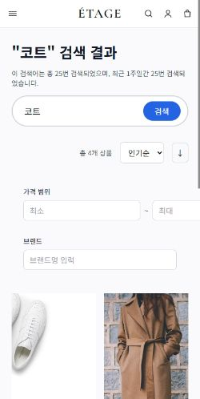

# 쇼핑몰 화면 성능 측정 (docs/perf/after-d2)

- 측정 일시: 2026. 11. 18. 오전 10:43:35
- 도구: lighthouse@12.6.1, 모바일 기본 환경(느린 4G·CPU 감속), 로컬 미리보기 빌드(`vite preview`) + 로컬 Supabase 시드 데이터
- 방법: 페이지마다 3회 측정, 성능 점수 중앙값 회차 기록. 상품 이미지는 Unsplash에서 받아오므로 네트워크 상태의 영향을 받음

| 페이지 | 성능 | 접근성 | 권장 사항 | 검색 최적화 | 첫 화면 표시(FCP) | 가장 큰 요소 표시(LCP) | 차단 시간(TBT) | 레이아웃 밀림(CLS) | 성능 3회 |
|---|---|---|---|---|---|---|---|---|---|
| 홈 | 70 | 100 | 96 | 91 | 4.06초 | 5.38초 | 6ms | 0.001 | 70 / 75 / 68 |
| 카테고리(여성) | 66 | 100 | 96 | 91 | 2.82초 | 7.77초 | 236ms | 0.000 | 66 / 66 / 60 |
| 상품 상세 | 70 | 98 | 96 | 91 | 2.82초 | 7.02초 | 67ms | 0.080 | 68 / 70 / 70 |
| 검색 결과(코트) | 71 | 93 | 96 | 91 | 2.74초 | 6.38초 | 151ms | 0.000 | 71 / 72 / 62 |

## 화면 캡처 (측정 마지막 화면, 모바일 크기)

- 홈: 
- 카테고리(여성): 
- 상품 상세: 
- 검색 결과(코트): 
